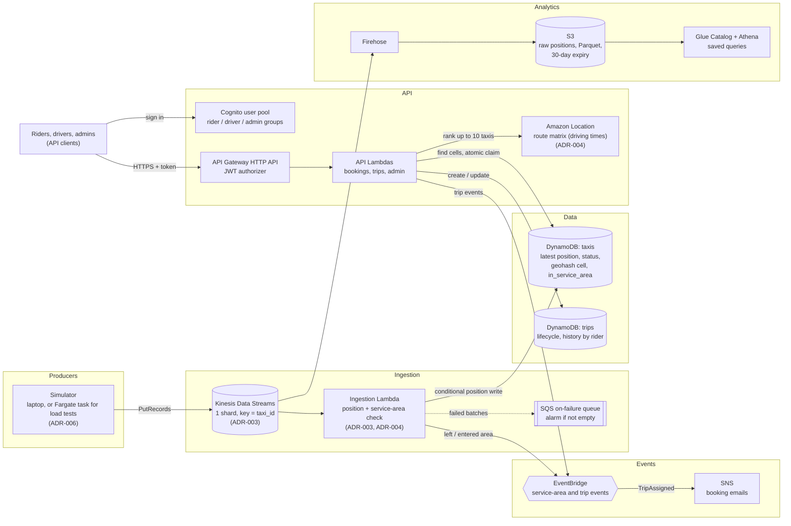
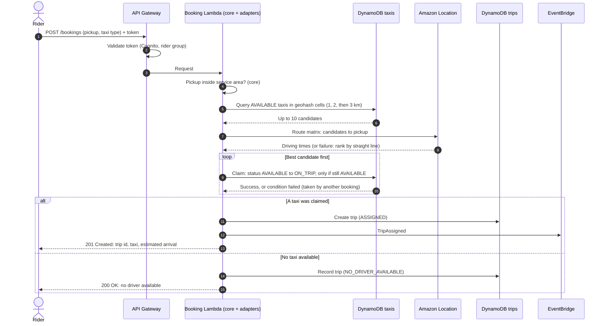
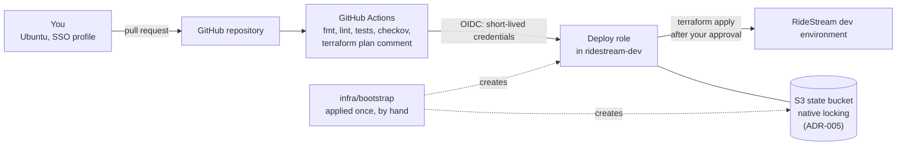

# RideStream — architecture

Status: v1 design · Week 1 · 10 November 2026. Each element links back to
the requirements (`docs/requirements.md`) and the ADRs (`docs/adr/`).

The diagrams are written in Mermaid, which GitHub draws directly from this
file. They live in the repository next to the code, and every change to them
shows up in a pull request like any other change. A polished image with AWS
icons is planned for the README in week 10.

## 1. System overview

Not shown: CloudWatch (logs, metrics, traces, dashboard and alarms for every
component, NFR-11) and the deployment path (section 4).

## 2. Ingesting a position

1. The simulator sends positions in batches with `PutRecords`, using the taxi
   id as the partition key, so each taxi's positions stay in order.
2. Lambda reads a batch from the stream (up to 100 records, or 1 second).
3. For each record, the core works out the geohash cell and checks the
   position against the Greater London polygon (ADR-004).
4. The DynamoDB adapter writes the position only if it's newer than the
   stored one, and never touches `status` (ADR-003).
5. If `in_service_area` changed, a `TaxiLeftServiceArea` or
   `TaxiEnteredServiceArea` event goes to EventBridge.
6. The function reports any failed records. Only those are retried, at most
   twice. A batch that still fails is recorded in the SQS queue, which raises
   an alarm.
7. Firehose reads the same stream independently and writes every position to
   S3 for Athena.

## 3. Booking a taxi

The claim in step 9 is the conditional write that makes double booking
impossible (NFR-05). Two simultaneous bookings can both pick the same taxi,
but only one claim succeeds. The other moves on to its next candidate.

## 4. Deployment and access

No AWS keys are stored anywhere. You sign in with SSO. The pipeline gets
short-lived credentials through OIDC, and each Lambda and the simulator task
has its own least-privilege role.

## 5. Component summary

| Component | Service | Decided in |
| --- | --- | --- |
| Simulator | Container: local, or Fargate task | ADR-006 |
| Position stream | Kinesis Data Streams, provisioned, 1 shard | ADR-003 |
| Ingestion | Lambda, Python 3.14, Powertools | ADR-001, ADR-003 |
| Service-area check | Core Python, Greater London GeoJSON | ADR-004 |
| Operational data | DynamoDB on-demand: taxis, trips | ADR-002 |
| Sign-in | Cognito user pool with groups | FR-01–03 |
| API | API Gateway HTTP API, JWT authorizer, Lambda | FR-09–21 |
| Driving times | Amazon Location route matrix | ADR-004 |
| Events and notifications | EventBridge, SNS email | FR-07, FR-17 |
| Analytics | Firehose, S3 (Parquet), Glue Catalog, Athena | FR-22–23 |
| Observability | CloudWatch logs, metrics, dashboard, alarms; X-Ray traces | NFR-11 |
| Infrastructure and delivery | Terraform, GitHub Actions with OIDC | ADR-005 |
